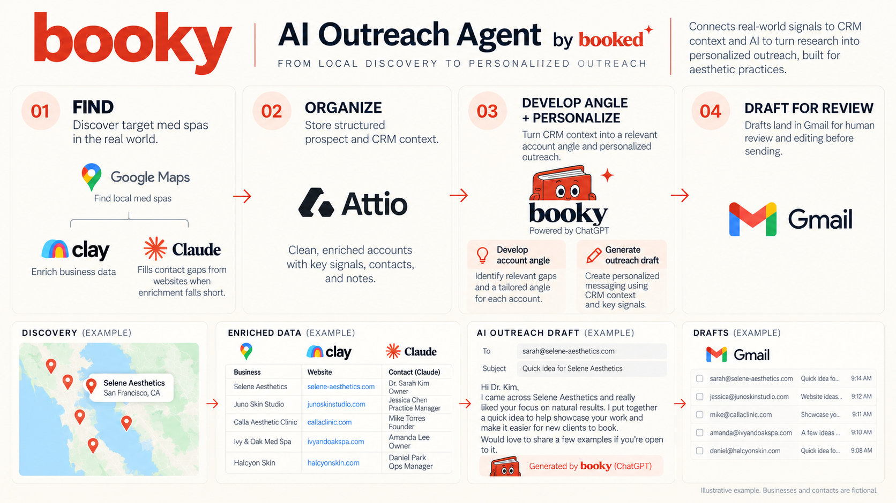

# Booky | GTM Outreach Agent

**Turning fragmented local-business data into actionable prospect research and personalized outreach.**

Built for [Booked](https://itsbooked.io/), Booky connects prospect research, enrichment, CRM context, and AI-assisted workflows into a repeatable outreach process, with human review before sending.

## The Problem

Traditional B2B enrichment tools often struggle with local businesses.

Finding the right decision-maker, identifying contact information, and developing a relevant outreach angle requires research across fragmented sources.

The challenge isn't just finding more prospects. It's turning incomplete information into useful context for personalized outreach.

## How It Works

**Google Maps → Clay → Claude → Attio → ChatGPT → Gmail**

| Tool | Role |
|------|------|
| Google Maps | Discover local businesses and identify potential prospects |
| Clay | Enrich business records and organize prospect research |
| Claude | Research business websites and extract missing contact information |
| Attio | Centralize account records, contacts, and CRM context |
| ChatGPT | Turn account context into personalized outreach drafts |
| Gmail | Deliver human-reviewed outreach |

The workflow connects research, enrichment, and execution while keeping human judgment in the loop.

## What I Built

- **Prospect research and enrichment:** Workflows for identifying local businesses and finding decision-makers when traditional enrichment falls short.
- **CRM-connected outreach:** Connected Attio account context to ChatGPT to support personalized outreach.
- **Account-specific personalization:** Research-driven messaging based on each business's digital presence and potential opportunities.
- **Human-in-the-loop execution:** Outreach drafts are reviewed before sending rather than automatically delivered.

## What I Learned

**Better outreach starts with better context, not better prompts.**

Building Booky reinforced three principles:

1. **Data quality determines output quality.** AI cannot reliably personalize outreach without useful account information.
2. **Integrations create leverage.** Connecting research, enrichment, and CRM context reduces repetitive work and fragmented workflows.
3. **Human judgment remains essential.** Automation should support decisions, not replace them.

The most interesting challenge wasn't generating emails. It was designing a system that turns fragmented information into actionable GTM context.

---

**Built for Booked** | GTM Systems, Data & AI

*This repository documents the system's architecture and design principles. Proprietary workflows, prompts, credentials, and customer data are intentionally excluded.*
